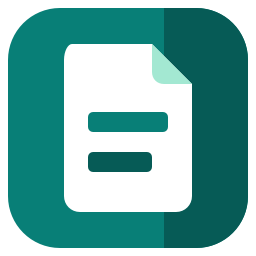
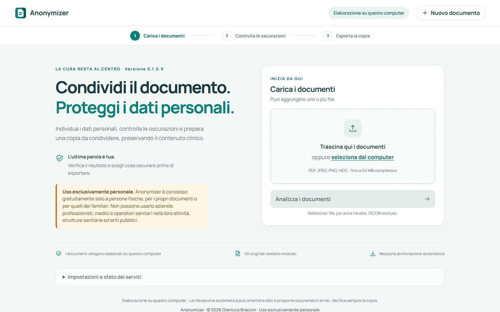
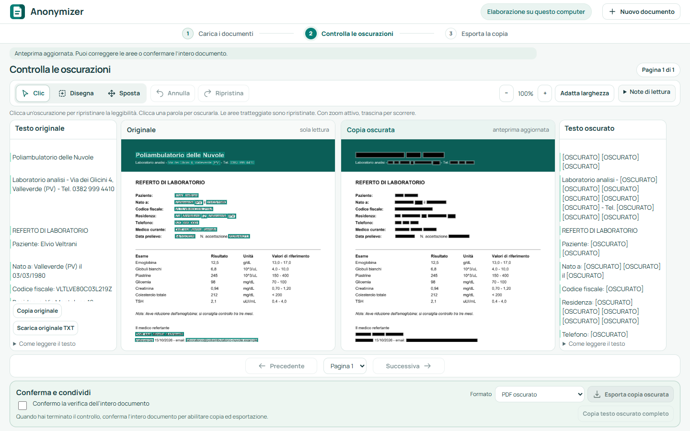
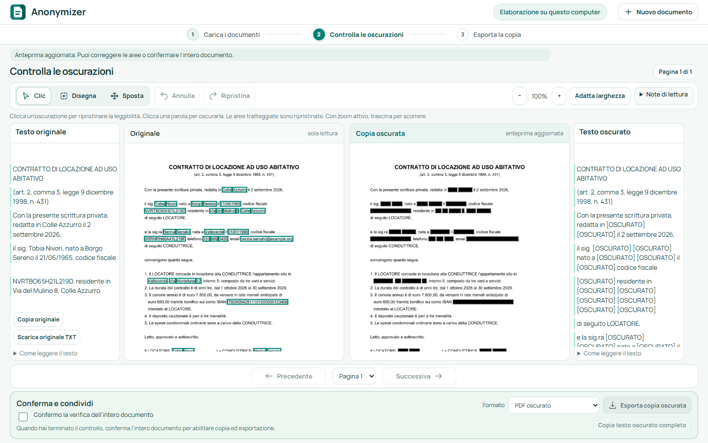
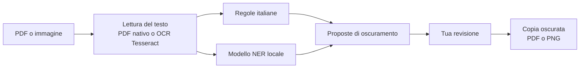

  

<h1 align="center">Anonymizer</h1>

  <strong>Oscura i dati personali nei documenti italiani, direttamente sul tuo computer.</strong> 
  Nessun modello linguistico, nessun cloud, nessun invio dei documenti.

  
  
  
  

  

> [!IMPORTANT]
> **Uso esclusivamente personale.** Anonymizer è gratuito per le persone fisiche, sui
> propri documenti o su quelli dei familiari. Non è consentito l'uso ad aziende,
> professionisti, medici e operatori sanitari nella loro attività, strutture sanitarie
> ed enti pubblici. Dettagli nella [licenza](LICENSE).

> [!WARNING]
> **Prototipo, non pronto per un uso professionale.** Anonymizer è uno studio di
> fattibilità. Il software è fornito **"così com'è"**, senza supporto e senza alcuna
> garanzia di funzionamento. L'oscuramento automatico può non riconoscere alcuni dati
> personali: **l'autore declina ogni responsabilità** per l'uso del programma e per i
> danni derivanti da errori o da mancate anonimizzazioni, nei limiti consentiti dalla
> legge. Chi usa Anonymizer è l'unico responsabile della verifica dei documenti prima
> di condividerli.

## Cos'è

Anonymizer prende un PDF o una foto di un documento e produce una **copia oscurata**:
nomi, codici fiscali, indirizzi, telefoni e gli altri dati che identificano una persona
diventano barre nere, mentre il resto del contenuto resta leggibile. Prima di esportare
vedi l'originale e la copia affiancati, e decidi tu cosa oscurare.

Funziona con **qualsiasi documento italiano**: lettere, contratti, moduli, certificati,
documenti d'identità. È però progettato con un'attenzione particolare ai **referti
clinici e ai documenti sanitari**, dove bisogna togliere i dati della persona senza
perdere le informazioni utili: valori degli esami, unità di misura, diagnosi e terapie
restano al loro posto.

Un caso tipico: vuoi chiedere un parere su un esame o condividere un documento, ma non
vuoi che il tuo nome, il codice fiscale o l'indirizzo finiscano in giro. Anonymizer ti
prepara una copia da condividere in pochi passaggi.

## Come si usa

**1. Carica i documenti.** Trascini uno o più file PDF, JPEG, PNG o HEIC.

**2. Controlla le oscurazioni.** Anonymizer legge il documento, propone le aree da
oscurare e mostra originale e copia uno accanto all'altro, insieme al testo letto.

  

Nel referto qui sopra sono oscurati paziente, luogo e data di nascita, codice fiscale,
residenza, telefono, medici, struttura e data del prelievo. I valori degli esami, gli
intervalli di riferimento e la nota clinica restano leggibili.

Con un clic ripristini un'area oscurata per errore, oppure oscuri una parola sfuggita.
Con lo strumento **Disegna** copri a mano firme, timbri, foto o codici a barre.

**3. Esporta la copia.** Dopo aver confermato la verifica dell'intero documento scarichi
un PDF oscurato, un'immagine PNG oppure il PDF insieme al testo oscurato. Il PDF
esportato contiene **solo immagini**: il testo originale non resta nascosto sotto le
barre nere e non si può recuperare con un copia e incolla.

Lo stesso flusso vale per documenti non sanitari, come questo contratto di locazione:

  

> Tutti i nomi, i codici fiscali e i recapiti nelle schermate sono **inventati**.

## Cosa riconosce

| Categoria | Esempi |
| --- | --- |
| Persone | Pazienti, familiari, medici e firmatari, anche quando il nome si ripete in altre pagine |
| Identificativi | Codice fiscale con verifica del carattere di controllo, tessera sanitaria, numeri di pratica e di accettazione |
| Documenti d'identità | Campi di carta d'identità, patente e passaporto, compresa la zona MRZ |
| Recapiti | Indirizzi, CAP, località, telefoni fissi e cellulari, email |
| Dati bancari | IBAN |
| Date | Date di nascita, anche nella forma "nato a … il …"; le altre date sono valutate in base al contesto |
| Strutture | Ospedali, ambulatori, laboratori e altre strutture citate nel documento |

Il riconoscimento non è perfetto: per questo la revisione è sempre obbligatoria prima
dell'esportazione.

## Come funziona

Anonymizer **non usa modelli linguistici di grandi dimensioni**: né servizi remoti come
ChatGPT, né modelli locali da far girare con Ollama, LM Studio o strumenti simili.
Nessun modello generativo riscrive il testo o ricostruisce l'immagine.

Il riconoscimento combina due approcci:

- **Programmazione tradizionale.** Regole esplicite e verificabili per i formati italiani:
  struttura e carattere di controllo del codice fiscale, telefoni, IBAN, date, etichette
  dei moduli come "Paziente:", "Cognome:" o "Medico curante", disposizione dei campi
  nella pagina e documenti d'identità.
- **Intelligenza artificiale mirata.** Un piccolo modello di riconoscimento delle entità
  (NER), [GLiNER multilingue](https://huggingface.co/urchade/gliner_multi-v2.1), trova
  nomi di persone, luoghi e strutture sanitarie che le regole non possono prevedere. È un
  modello che classifica parole già presenti nel testo, non genera testo, e gira sul
  processore tramite ONNX Runtime.

Le regole cliniche distinguono i dati della persona dal contenuto sanitario: negazioni,
valori, unità di misura e termini medici non vengono oscurati anche quando somigliano a
nomi propri.

## Privacy e funzionamento locale

- **Tutto sul tuo computer.** Il programma avvia un servizio raggiungibile solo dal PC
  stesso; i documenti non vengono inviati a nessun server.
- **Nessuna archiviazione.** Documenti e risultati non vengono conservati: esiste solo
  la copia che scegli di esportare. I file temporanei usati durante la lettura vengono
  eliminati al termine dell'elaborazione.
- **Originali intatti.** Il file di partenza non viene mai modificato.
- **Una sola connessione, al primo avvio.** L'installer scarica una volta il modello NER
  pubblico da Hugging Face, circa 1,16 GB, e ne verifica l'integrità. Da quel momento
  Anonymizer funziona anche senza Internet. La versione portable completa include già il
  modello e non si collega mai.

## Installazione

Anonymizer è pensato per **Windows 10 e 11 a 64 bit** e non richiede privilegi di
amministratore.

1. Scarica `Anonymizer-Setup-<versione>-x64.exe` dalla pagina **Releases** del
   repository.
2. Avvia l'installer, leggi e accetta la licenza d'uso personale e scegli i collegamenti.
3. Al primo avvio attendi il download e la verifica del modello.

Python, OCR italiano e tutte le librerie sono inclusi: non serve installare altro.
Servono circa 3 GB di spazio su disco, modello compreso. L'installer non è firmato
digitalmente, quindi Windows può mostrare un avviso di SmartScreen.

Istruzioni dettagliate, requisiti e disinstallazione sono in
[windows-installer.md](docs/windows-installer.md).

## Limiti e responsabilità

Anonymizer è un prototipo distribuito senza supporto, aggiornamenti garantiti o
garanzie di alcun tipo. Non è adatto a un uso professionale e non sostituisce le
procedure, le valutazioni e gli strumenti richiesti a chi tratta dati personali per
lavoro.

- Il riconoscimento automatico può **omettere dati** o **oscurare troppo**: controlla
  sempre ogni pagina prima di esportare.
- Firme, timbri, fotografie e codici QR non vengono riconosciuti in automatico e vanno
  coperti con **Disegna**.
- Anche un documento oscurato può permettere di risalire a una persona attraverso il
  contesto, per esempio una malattia rara o un evento descritto in dettaglio.
- I file DICOM delle immagini radiologiche non sono supportati.
- Anonymizer non è un dispositivo medico e non fornisce valutazioni cliniche.

L'autore non risponde di dati personali rimasti visibili, di oscuramenti errati né di
alcuna conseguenza della condivisione dei documenti prodotti. Le condizioni complete
sono negli articoli 7 e 8 della [licenza](LICENSE).

## Per sviluppatori

Il progetto è scritto in Python 3.12 con un'interfaccia HTML, CSS e JavaScript condivisa
tra browser locale e finestra desktop Qt. Ambiente di sviluppo, struttura del
repository, build Windows e riga di comando sono descritti nella
[guida per sviluppatori](docs/sviluppo.md). Specifica, piano e criteri di verifica
sono nella cartella [docs](docs).

Il codice è documentato in italiano in formato Doxygen: con Doxygen installato,
`doxygen Doxyfile` genera la documentazione in `build/doxygen/html/index.html`.

## Licenza

Copyright (C) 2026 Gianluca Braccini. Tutti i diritti riservati.

Anonymizer non è software open source. Il codice è pubblico per trasparenza e
studio, ma l'uso è regolato dalla [licenza d'uso personale](LICENSE):

- **Consentito.** Le persone fisiche possono usarlo gratuitamente solo per
  scopi privati, sui documenti propri o dei familiari.
- **Vietato.** Non possono usarlo aziende, professionisti, medici e altri
  operatori sanitari nella loro attività professionale, pubbliche
  amministrazioni, strutture sanitarie ed enti di qualsiasi tipo.
- **Altri usi.** Per un uso professionale o commerciale serve una licenza
  separata, da chiedere a gianluca.braccini@gmail.com.

Le librerie, i modelli e le regole di terze parti mantengono le rispettive
licenze; le regole incluse in `src/anonymizer/data` sono elencate in
[third-party-rules.md](docs/third-party-rules.md).

Il programma è fornito senza alcuna garanzia e non è un dispositivo medico.
L'oscuramento proposto richiede sempre revisione umana e non garantisce
l'anonimato dei documenti.
